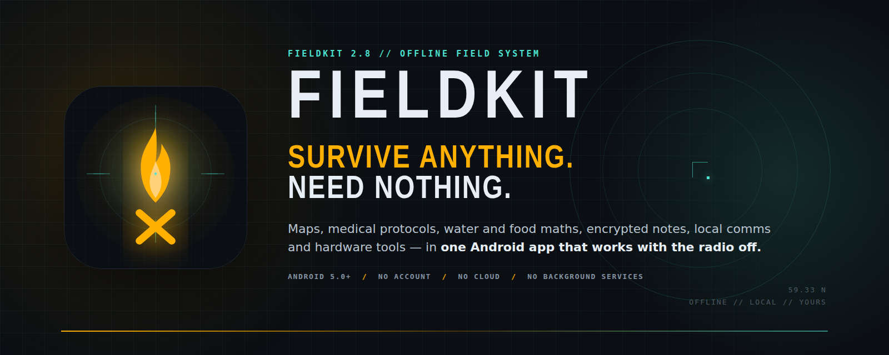
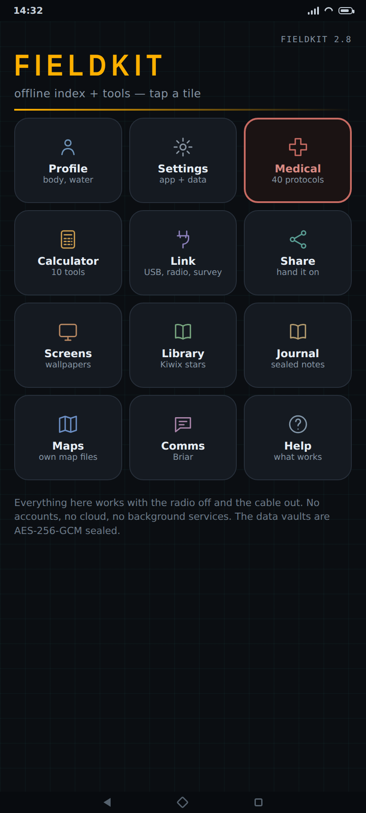
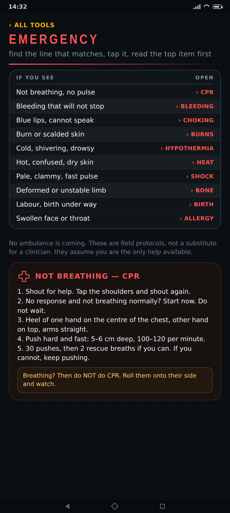
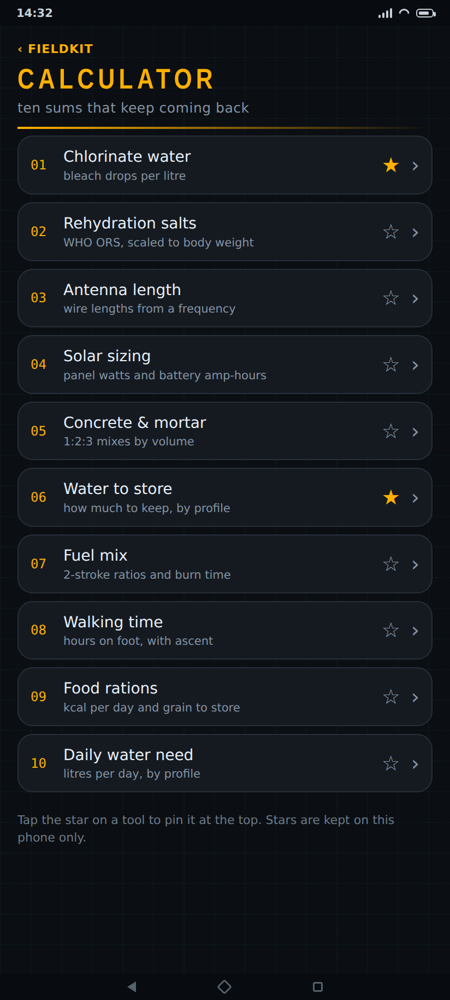
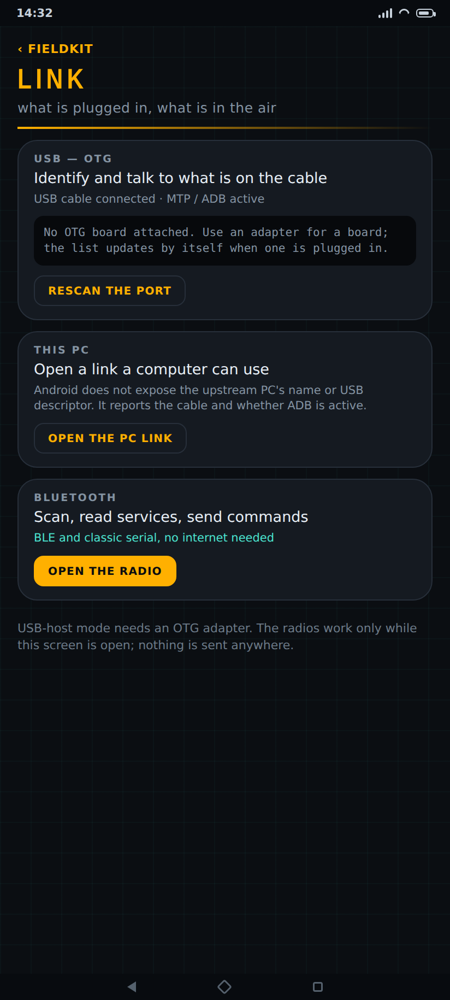

<p align="center">
  
</p>

<h1 align="center">FIELDKIT</h1>

<p align="center">
  <b>The offline survival toolkit that already lives in your pocket.</b><br>
  For the end of the world. For the end of the road. For a wet weekend in a tent.
</p>

<p align="center">
  <a href="../../releases/latest"></a>
  
  
  
  
</p>

---

**FieldKit turns an Android phone into a field instrument.** Not a bunker. Not a subscription. Not another app that dies with the signal bars. It is a small, self-contained survival kit for the day the map ends — and for the far more common day when you simply want to be ready.

It carries the medical protocols you hope you never need, the water and food maths you will need, an offline map viewer, an encrypted field journal, a local peer link that works phone-to-phone without a server, and the unglamorous hardware tools that make a phone useful when something with a serial port needs talking to.

**No account. No cloud. No background services. No signal required.**

> **FieldKit is a tool, not a guarantee.** It will not replace training, a doctor, a satellite messenger, or good judgement. It tells you what to do next — you still have to do it.

---

## Why it exists

The usual survival app wants a login, a data connection, and permission to phone home. The usual offline app is a folder of PDFs with no index. FieldKit sits between them: the index, the arithmetic, the protocols and the radios, in one APK that works with the phone in aeroplane mode.

- **The grid goes down.** You still have the medical triage list, the water calculations, the map you saved, and a journal that stays sealed on the phone.
- **You are camping and the weather turns.** You have walking times, water storage, food rations, rope-and-radio maths, and a way to hand the app to someone else's phone.
- **Someone is hurt, and the ambulance is an hour away.** You have 40 field protocols, written to be read at speed in bad light.
- **A board, sensor or radio will not talk.** You have USB OTG, BLE, classic serial and a PC link — with honest errors instead of a spinner.
- **You want to disappear for a week.** There is no account to cancel, no server to trust, and no background process quietly reporting back.

## One screen. Twelve tools.

| Tile | What it actually gives you |
| --- | --- |
| **Profile** | A party list with body mass, conditions, allergies, water and food needs. The maths follows the people, not a generic adult. |
| **Settings** | Passcode, palettes, advanced mode, permissions review, peer beacon, low-battery mode and the home-screen widget. |
| **Medical** | 10 core emergency protocols with a “if you see this, open that” triage table. Advanced mode adds 30 more with the criteria that tell them apart. |
| **Calculator** | 10 field sums: chlorinating water, WHO rehydration salts, antenna length, solar sizing, concrete and mortar, water storage, two-stroke fuel, walking time, food rations and daily water. |
| **Link** | USB device identification and serial consoles, BLE service inspection, Bluetooth SPP, a PC link over ADB or Bluetooth, and an opt-in Wi-Fi/Bluetooth survey. |
| **Share** | Hand a file or the FieldKit APK to another phone, with an option to strip photo metadata before it leaves. |
| **Screens** | Draw and set a home or lock wallpaper on the device. No image file, no download. |
| **Library** | Keep starred Kiwix pages and jump back into the offline library you installed. The articles stay in Kiwix. |
| **Journal** | A timestamped field log behind the passcode, sealed with AES-256-GCM. |
| **Maps** | Read a raster MBTiles file you already have, drop waypoints, see distance and compass bearing from the latest fix, import and export GPX. |
| **Comms** | Open Briar if it is installed. FieldKit does not bundle a messenger or invent one. |
| **Help** | The manual: what works, what fails, what the error codes mean and what the app deliberately cannot do. |

## Screens

<div align="center">
<table>
  <tr>
    <td></td>
    <td></td>
    <td></td>
    <td></td>
  </tr>
  <tr>
    <td align="center"><sub>Home</sub></td>
    <td align="center"><sub>Emergency</sub></td>
    <td align="center"><sub>Field maths</sub></td>
    <td align="center"><sub>Hardware</sub></td>
  </tr>
</table>
</div>

<sub>The screens above are interface previews rendered from the 2.8 layouts and copy. Hardware-dependent states are illustrative; the app is the source of truth.</sub>

## What it is not

This matters as much as the feature list:

- **Not an archive.** FieldKit contains no Wikipedia, books, maps or media. Install Kiwix and download a ZIM; supply your own raster MBTiles map. FieldKit keeps the links, the maths and the protocols.
- **Not a satellite messenger.** The peer feature is a local-network beacon. It does not reach the internet, a cell tower, or a rescue service.
- **Not a doctor.** The medical screens are field protocols for when you are the only help available. They do not diagnose, prescribe, or replace a clinician.
- **Not a hacker's toolkit.** The survey lists nearby Wi-Fi and Bluetooth devices; it does not join networks, capture packets, or break encryption.
- **Not an FM transmitter.** The radio screen reports real radio state and does the frequency/channel arithmetic. Android gives apps no API to retune the phone's own FM transmitter.
- **Not full-disk encryption.** The passcode hides screens and seals the app's vaults. It does not encrypt the phone's storage.
- **Not a background service.** Screens do their work while you are looking at them. The peer beacon and survey stop when you leave the screen.

## Install

Download the signed APK from the [latest release](../../releases/latest), or use the copy in [`dist/`](dist/FieldKit-2.8.apk).

```bash
adb install -r FieldKit-2.8.apk
```

On a locked-down device, Android may refuse a fresh package with `INSTALL_FAILED_VERIFICATION_FAILURE`. Read the current verifier value, turn it off for the install, then restore it:

```bash
adb shell settings get global package_verifier_enable      # note the value
adb shell settings put global package_verifier_enable 0
adb install -r FieldKit-2.8.apk
adb shell settings put global package_verifier_enable <old value>
```

The build is signed with a debug keystore, so updating over a differently signed copy fails. Uninstall the old copy first in that case.

Verify the download before installing:

```bash
sha256sum FieldKit-2.8.apk
# 2a7120dce249698ecfaa5ba92c402cfa5d9e06cb2e262cb9ce4a60acb039f922
```

## What's new in 2.8

- **Honest USB cable reporting.** When the phone is plugged into a PC it is the USB device, so the PC cannot appear in `UsbManager.getDeviceList()`. Link now reports the cable and data state (`USB data link active (ADB)`, `USB cable connected`, or `No USB cable`) and says plainly that the upstream PC's name is not exposed.
- **PC link over the cable.** The PC Link screen can answer a computer over an ADB-forwarded loopback socket on port 47778, with a banner and echo. Bluetooth SPP remains the no-ADB route.
- **The 2.7 foundation:** encrypted journal, GPX import/export with distance and bearing, richer BLE and USB reporting, and encrypted peer short messages.
- **The 2.6 foundation:** Kiwix library prompt, the twelve-tile menu, and the current security and installation flow.

## Security posture

- `allowBackup="false"` and `usesCleartextTraffic="false"`.
- No accounts, no cloud, no analytics and no background services.
- The passcode is stored as salted PBKDF2 (120,000 rounds); the record is wrapped with AES-256-GCM in the Android keystore, and a wrong code never reaches the stored hash.
- The journal and saved-entity roster are AES-256-GCM sealed before they touch storage.
- Peer beacons are AES-256-GCM sealed with a key derived from the shared network code, never from the passcode. A phone with a different code cannot read the packet.
- The `INTERNET` permission exists only so the opt-in peer feature can open a local UDP socket. No remote address is hardcoded or contacted.
- Shared photos can be re-encoded to strip EXIF before they leave the phone.

The honest limit: the passcode locks the **interface**, not the disk. Anyone who can read the phone's storage can read the files. Encryption of the whole profile would make the app unable to search while locked and would destroy the data if the password were forgotten.

## Compatibility

One APK. Plain framework Java. No AndroidX, no Google Play services, no Gradle at build time.

It installs on Android 5.0+ across AOSP, GrapheneOS, LineageOS, OxygenOS, One UI and the rest. Calls that need a newer API sit behind `Build.VERSION.SDK_INT` checks. Ubuntu Touch and other non-Android Linux phones cannot install an APK; Waydroid can run this one.

## Build facts

Verified from the published binary:

| | |
| --- | --- |
| Package | `se.blimark.fieldkit` |
| Version | 2.8 (versionCode 19) |
| SDK | `minSdkVersion 21`, `targetSdkVersion 34` |
| Toolchain | build-tools 35.0.0 (`aapt2`, `d8`, `zipalign`, `apksigner`), platform `android-34`, JDK 17 with `javac --release 8` |
| Classes in `classes.dex` | 279 |
| APK size | 168,573 bytes |
| SHA-256 | `2a7120dce249698ecfaa5ba92c402cfa5d9e06cb2e262cb9ce4a60acb039f922` |
| MD5 | `214ea917ed6ddc68531916248e423fca` |

The Java source is not part of this repository. [`FIELDKIT-BUILD-PROCESS.txt`](FIELDKIT-BUILD-PROCESS.txt) documents the source layout, every screen's behaviour, the security review and the exact build pipeline; [`SKILL.md`](SKILL.md) is the reusable build skill.

## Repository contents

| Path | What it is |
| --- | --- |
| [`dist/FieldKit-2.8.apk`](dist/FieldKit-2.8.apk) | Signed 2.8 build (versionCode 19) |
| [`FIELDKIT-BUILD-PROCESS.txt`](FIELDKIT-BUILD-PROCESS.txt) | Environment, source layout, screen behaviour, security review, verification log and known limits |
| [`SKILL.md`](SKILL.md) | Reusable `aapt2` + `javac` + `d8` build skill: no Gradle, no layouts, runtime-drawn screens, USB/BLE, passcode, AES vaults, MBTiles and the PC link |
| [`assets/brand/`](assets/brand) | FieldKit mark, app icon and repository banner |
| [`assets/screenshots/`](assets/screenshots) | Interface previews used above |

## Known limits

- Maps must be **raster MBTiles** (PNG or JPEG tiles). A plain `.sqlite`, a folder of tiles, or a vector map will not open.
- Kiwix, map apps and Briar are **not bundled**, and no content is included. FieldKit opens what you installed.
- No online tile fetching, no downloads, no browser.
- USB serial is driven for CDC-ACM, CP210x, CH340/CH341 and FTDI bridges. Other boards are identified but marked unsupported.
- The cable PC link needs USB debugging and `adb`; Bluetooth SPP is the no-ADB route.
- The peer feature needs both phones on the same local network with the same network code, and both Peers screens open. It is a beacon, not a persistent connection.
- The survey needs location permission for Wi-Fi scan results, even though the app does not use your location.
- The medical protocols are deliberately blunt. They are not a substitute for a clinician, and they assume evacuation may be impossible.

## Licence

No licence has been chosen for this repository, so the default applies: **all rights reserved**. You may run and read the published app; you may not modify or redistribute it without permission.
